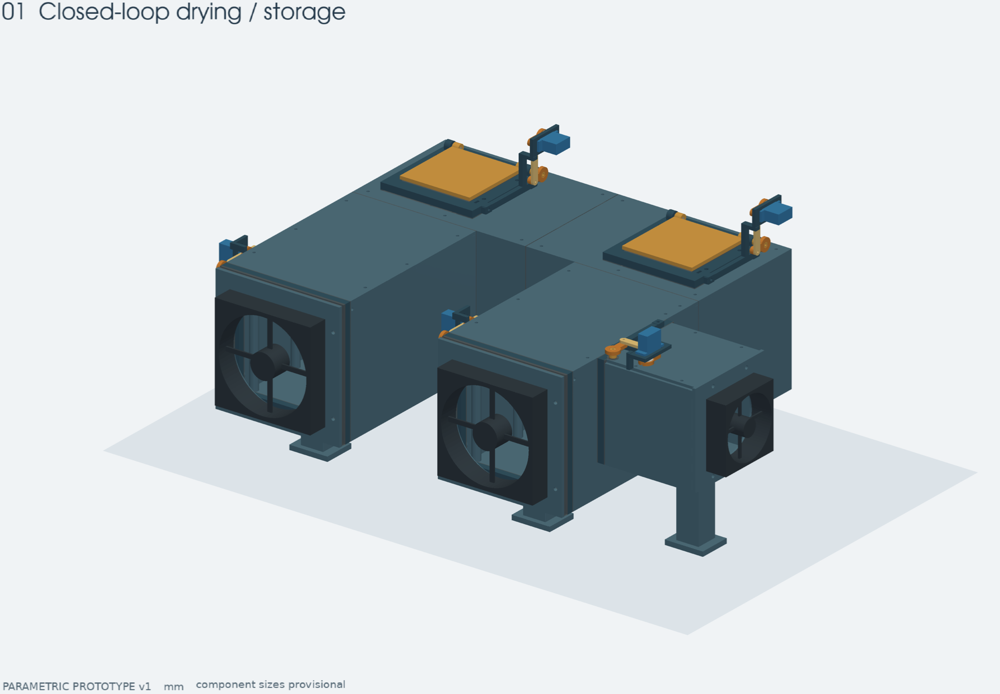

# Активный сухой бокс для филамента

Приставка к ящику для сухого хранения филамента с циркуляцией воздуха через
силикагель и отдельной регенерацией сорбента. Репозиторий объединяет механику,
документацию, будущую электронику и прошивку.



Сейчас готов параметрический **механический прототип v1**. Размеры ящика оценены
по фотографиям, посадки комплектующих предварительные. Электроника и прошивка
ещё не реализованы. Геометрия проверена программно; герметичность, усилия
приводов, нагрев и эффективность сушки требуют физических испытаний.

## Структура

```text
cad/                     Параметрические модели и инструменты сборки
  drybox_cad/            Геометрия, параметры, шаблоны и рендеринг
  parameters/            Редактируемые наборы параметров
  build.py               Сборка и проверки геометрии/экспортов
  render_project.py      Отдельный рендеринг проверенной сборки
  verify_delivery.py     Аудит результатов и соответствия исходникам
  requirements.lock.txt  Зафиксированные зависимости CAD
docs/                   ТЗ, сборка, решения и правила работы с Git
  images/                Изображения прототипа для документации
electronics/            Будущие схемы, платы и состав электроники
firmware/               Будущая прошивка контроллера
scripts/                Общие инструменты проекта: упаковка
build/cad/              Экспорты, изображения и отчёты; генерируется, вне Git
dist/                   Архивы поставки; генерируется, вне Git
```

Папки `build/` и `dist/` не хранятся в Git. STEP/STL и чертежи получаются из
CAD-исходников; изображения в `docs/images/` хранятся как иллюстрации к текущему
описанию и обновляются при изменении конструкции. В Git попадают также будущие
ручные CAD-файлы, схемы и исходники прошивки, а не результаты их сборки.

## Документация

- [Требования, размеры, оси и режимы работы](docs/DESIGN_BRIEF.md)
- [Печать, покупки, изготовление прокладок и сборка](docs/ASSEMBLY.md)
- [CAD: параметры, окружение, команды и результаты](cad/README.md)
- [Открытые решения: фиксация заслонок и дальнейшие испытания](docs/DESIGN_DECISIONS.md)
- [Ветки, коммиты и порядок работы](docs/DEVELOPMENT.md)
- [Электроника](electronics/README.md) · [Прошивка](firmware/README.md)

## Быстрый запуск CAD

Из корня репозитория, в окружении с зависимостями из `cad/requirements.lock.txt`:

```sh
make build
```

Для существующей локальной среды:

```sh
make build PYTHON=/Users/xartik/3d_models/.venv/bin/python
```

`make geometry` собирает без изображений, `make render` перерисовывает проверенную
геометрию, `make verify` проверяет результаты, `make package` создаёт ZIP в `dist/`.
Каждая команда поддерживает тот же аргумент `PYTHON=...`. Полный список: `make help`.

Результаты: `build/cad/exports/parts/`, `build/cad/exports/assemblies/`,
`build/cad/exports/templates/`, `build/cad/renders/`,
`build/cad/verification.json` и `build/cad/print_manifest.json`.

## Ветки

`main` содержит согласованные воспроизводимые версии, `develop` — текущую
разработку. Отдельные задачи выполняются в короткоживущих ветках `cad/...`,
`electronics/...`, `firmware/...` или `docs/...` от `develop`.
Наличие версии в `main` само по себе не означает, что прототип испытан физически.
