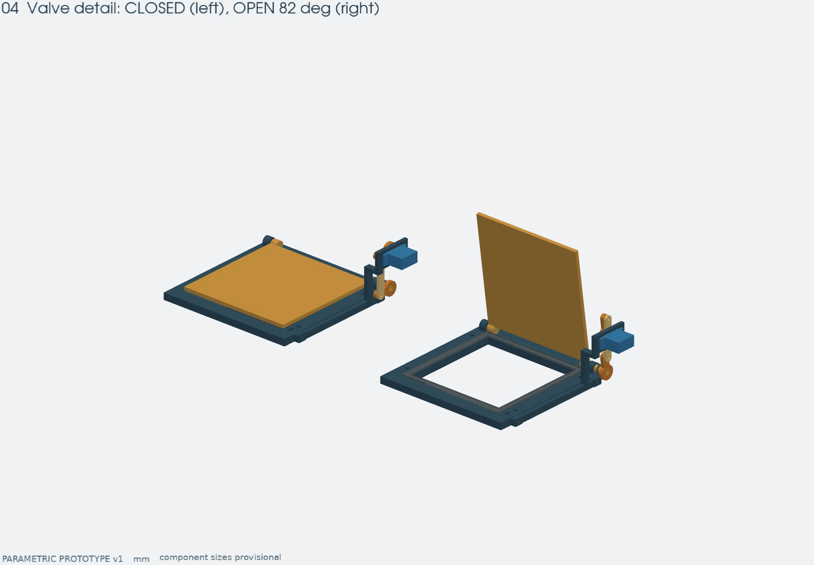
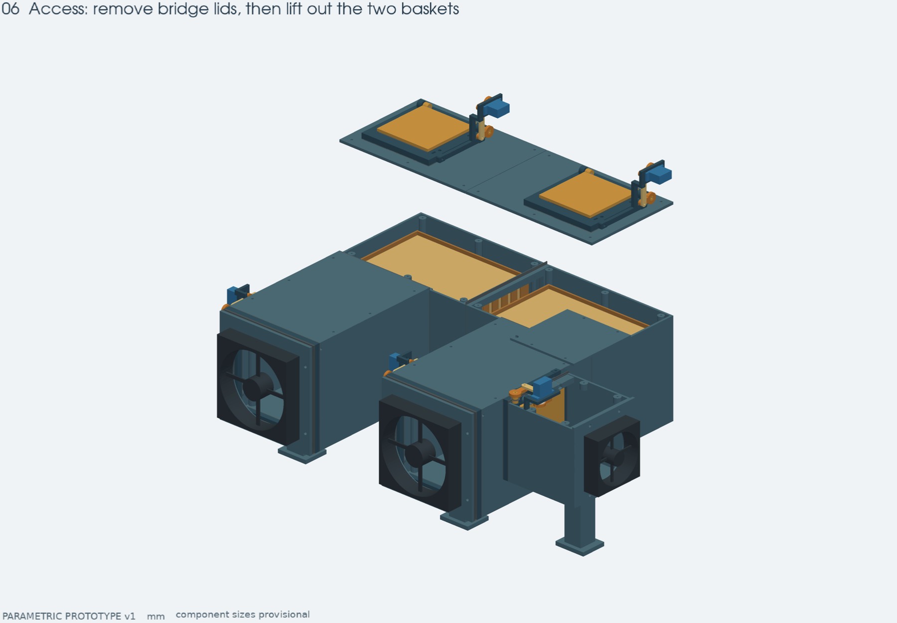

# Сборка прототипа

Это первая механическая версия с оценочными размерами ящика и условными
посадками комплектующих. Сначала соберите одну заслонку и приложите бумажные
шаблоны к ящику. Полный корпус имеет смысл печатать после этих двух примерок.

Пути к файлам ниже указаны от корня репозитория.

## Файлы и ориентация

Печатать файлы из `build/cad/exports/parts/*.stl`, единицы — мм. Они перенесены на стол
и ориентированы отдельно от положения в сборке. Количество — в `build/cad/print_manifest.json`.
Файлы сборок в `build/cad/exports/assemblies` уже расставлены по рабочим координатам;
силуэты вентиляторов, серв, мешочков и уплотнений в них не являются печатными деталями.

Корпуса печатать дном вниз, крышки плоской внешней стороной на стол, рычаги
и тяги широкой стороной на стол. У створок и рамок нужны локальные поддержки
под шарнирами; у задних фланцев корпусов — поддержка верхней перемычки проёма.
У боковой камеры проверить поддержки вокруг передних бобышек и заднего фланца.
Поддержки должны быть доступны для удаления через снятые крышки.

Начальная настройка: слой 0.2 мм, 4–5 периметров, достаточное число сплошных
слоёв у фланцев, без масштабирования STL. Это не проверенный профиль X2D.
Материал горячих деталей выбирается под фактическую температуру регенерации;
в этой версии конкретная температура и режим печати не зафиксированы.

## Что купить

| Деталь | Количество | Примечание |
|---|---:|---|
| Вентилятор 120×120×25 мм | 2 | условная толщина; монтажный квадрат 105 мм |
| Вентилятор/PTC-узел под посадку 80 мм | 1 | квадрат отверстий 71.5 мм; реальный PTC адаптировать отдельно |
| Серва класса SG90, 9 г | 5 | корпус-ориентир 23×12×23 мм; штатные качалки сохранить |
| Штатная двухсторонняя качалка SG90 | 5 | используются родные шлицы и центральный винт |
| Стальной пруток Ø3 мм | 5 отрезков по 20 мм | левая ось каждой заслонки |
| Силиконовый лист 2 мм | ≥300×300 мм | пять прокладок створок |
| Силиконовый лист 1 мм | ориентировочно 500×500 мм | стыки и шайбы; раскладка зависит от отходов |
| Мягкий силиконовый лист/лента 3 мм | для двух рамок 156 мм | наружный стык с ящиком, подгоняется по стенке |
| Нейтральный RTV-силикон | 1 тюбик | приклейка прокладок, крышки, герметизация неподвижных осей |
| Тканевые мешочки под силикагель | 2 | примерный полезный габарит каждого ≤184×115×38 мм |
| Гранулированный силикагель | по объёму мешочков | масса зависит от реальных гранул; не трамбовать вверх |
| M2×10 + гайки/шайбы | 10 комплектов | шарниры тяг; окончательную длину подобрать по сборке |
| M2×8 + гайки | 10 комплектов | адаптеры к родным качалкам |
| M2×10 и гайки | 10 комплектов | уши серв, если подходят выбранным сервам |
| M3×8 с широкой шайбой | 5 | удержание рычага на шестигранном конце оси |
| M3×16 + гайки | 10 | кронштейны серв к рамкам |
| M3×10 | 28 | крышки: 4×6 и камера входа ×4; отверстия пилотные |
| M4×40 + гайки/шайбы | 12 | 8 у ящика, 4 через клапан к боковой камере; уточнить по стенке |
| M4×35 + гайки/шайбы | 12 | 8 у вентиляторов 120, 4 у вентилятора 80 |
| M4×20 + гайки/шайбы | 24 | 8 стыки ножек, 4 центр, 8 верхние клапаны, 4 адаптер 80 |
| M4×50 + гайки/шайбы | 4 | основные ножки 50 мм |
| M4×90 + гайка | 1 | опора камеры 90 мм |

Крепёж — подбор для номинальной геометрии, запас 10–20% удобен. До покупки
проверьте реальную толщину стенки и уши выбранной сервы. В STEP винты не
изображены; отверстия и доступные гайкам места присутствуют.

## 1. Проверить посадки малой печатью

`fit_coupon.stl`: ряд Y=15 — отверстия Ø8.3 / 8.45 / 8.6 мм слева направо;
Y=30 — Ø3.1 / 3.3 / 3.5 мм; Y=44 — шестигранники 6.15 / 6.25 / 6.4 мм по граням.
`test_journal.stl` проверяет печатный Ø8 и шестигранник 6 мм.

Номинал проекта: отверстие Ø8.45 под печатный Ø8; отверстие Ø3.3 под сталь Ø3;
шестигранное гнездо 6.25 под выступ 6 мм. Посадка должна поворачиваться свободно,
без заметного заедания. Это начальные припуски, не гарантия посадки на принтере.
Изменения `journal_clearance` и `hex_clearance` в параметрах требуют пересборки.

Затем напечатайте комплект одной заслонки 80: рамка, створка, рычаг, адаптер
качалки, тяга, кронштейн. Проверьте реальную серву, весь ход и усилие на прокладке.
Момент 9-граммовой сервы не измерен; если ей тяжело, уменьшите сжатие/жёсткость
прокладки и устраните трение до сборки пяти приводов.

## 2. Сделать силиконовые детали

Откройте соответствующий `build/cad/exports/templates/*.svg` в браузере, распечатайте
**100%, без «вписать в страницу»**, проверьте линейкой контрольные 100 мм.
DXF содержит ту же геометрию в мм для плоттера/лазера, если материал и станок допускают.
Большие шаблоны можно разбить на страницы; масштаб менять нельзя.

1. Приложите шаблон к листу силикона, обведите тонким маркером.
2. Вырежьте наружный контур и окно острым ножом на подложке; круглые отверстия
   пробейте подходящим пробойником. Не прорезайте перемычки между контурами.
3. Для створок: 2 копии `flap_seal_120`, 3 копии `flap_seal_80`, лист 2 мм.
4. Приклейте их к плоским седлам рамок тонким слоем совместимого RTV,
   не заполняя рабочую поверхность. Выдержите полное время отверждения по инструкции RTV.
5. Створка в закрытом положении параллельна седлу. Номинальное сжатие 0.3 мм
   получается геометрией петли; после печати его обязательно проверить.
6. Вырежьте пять шайб по двум окружностям `journal_seal`: наружный Ø12,
   внутренний Ø8.1, толщина 1 мм. Квадрат вокруг окружностей — рамка шаблона,
   его не оставлять на шайбе. При необходимости подгоните отверстие под реальный вал.
7. Неподвижные левые стальные оси уплотните точкой RTV снаружи. Вращающиеся
   правые оси не заливать RTV; силиконовую шайбу посадить на корпус вокруг вала,
   обеспечить скольжение вала, при необходимости применить совместимую смазку.

Для крышек в модели есть канавка 0.8 мм глубиной и 2.4 мм шириной. Нанесите
в неё умеренный валик RTV, дайте сформироваться уплотнению по инструкции материала;
при формовании ответной поверхностью используйте разделительную плёнку, чтобы
крышка осталась съёмной. У крышки боковой камеры — стыки по кромкам: тонкая
силиконовая лента либо съёмный сформованный RTV-шов. Места выхода осей требуют
отдельной проверки утечек.

## 3. Собрать каждую заслонку

1. Удалите поддержки и заусенцы, проверьте отверстия. Пилот Ø2.5 на конце
   печатной оси подготовьте под M3 выбранным для материала способом; резьба
   в STL отсутствует. Не раскалывайте вал силовым вворачиванием.
2. Под углом заведите правый печатный журнал Ø8 в правую опору рамки,
   совместите левую петлю и вставьте стальную ось Ø3×20. Закрепите неподвижную ось
   так, чтобы створка сохраняла свободный ход.
3. Наденьте правую силиконовую шайбу после монтажа рамки в корпус.
4. Наденьте рычаг `crank` на шестигранник; плечо направлено в сторону середины
   створки в закрытом положении. Удержите винтом M3 с шайбой. Шестигранник
   передаёт момент, винт удерживает рычаг вдоль оси.
5. Прикрутите кронштейн к краю рамки двумя M3×16 с гайками в шестигранных карманах.
6. Установите серву в окно кронштейна. В модели заложен ориентировочный корпус
   и два паза под уши с межосевым 27.5 мм; реальная SG90 может отличаться.
7. Сохраните родную качалку. Соедините её с `horn_adapter` двумя M2 через
   продолговатые отверстия на радиусе 5–7 мм. Центральный винт должен удерживать
   родную качалку на шлицах; при необходимости подберите длину/рассверлите адаптер
   под фактическую головку. На обратной стороне адаптера есть разгрузка Ø8.5.
8. При закрытой створке выставьте оба плеча параллельно. Соедините их тягой
   с межосевым 42 мм двумя M2. Между тягой и рычагами оставьте тонкие шайбы,
   гайки затяните так, чтобы шарниры сохраняли ход; предпочтительны самоконтрящиеся.
9. Вручную пройдите 0…82°, затем настройте конечные положения сервы на малой
   скорости. Нельзя назначать электрические 0°/180° как механические упоры.
   При сжатии прокладки серва не должна постоянно гудеть.

Расчётная открытая створка наклонена на 82°, небольшой остаточный выступ
в проём остаётся. Проход и расход не равны паспортному расходу свободного вентилятора.

## 4. Собрать корпус и кассеты

1. Соедините половины перемычки через `bridge_centre_seal`, четыре M4×20.
2. Соедините каждую ножку с перемычкой через `leg_bridge_seal`, четыре M4×20 на стык.
   Гайки ставятся изнутри при снятых крышках.
3. Поставьте четыре опоры 50 мм под ножки и перемычку: центры X=±140,
   Y=65 и 330 мм. Закрепите M4×50, гайки в нижних шестигранных карманах глубиной 7 мм. Винты опор ставятся без шайбы под головкой, чтобы конец не выступал ниже подошвы.
4. Закрепите две верхние 80-мм заслонки через `exhaust_mount_seal`, по четыре M4×20.
5. Правую боковую 80-мм заслонку прижмите к стенке через `heater_mount_seal`.
   За ней располагаются `heater_hood_seal` и камера входа; передние гайки
   камеры доступны при снятой её крышке.
6. Поставьте пятую опору 90 мм под камеру: центр X=299, Y=110 мм. Закрепите
   M4×90. Камера несёт вентилятор и будущий нагреватель.
7. На наружный торец камеры поставьте `heater_fan_adapter`, затем вентилятор/PTC.
   Сам нагревательный элемент пока не моделировался: адаптер задаёт только
   вентиляторную посадку 80 мм. Герметизируйте этот неподвижный стык тонким RTV.
8. В каждую кассету положите тканевый мешочек. Не укладывайте его выше борта:
   в рабочем положении над кассетами предусмотрен свободный канал 97 мм.
   При снятой крышке кассеты поднимаются за борта; крышка снимается вместе с выпуском.
9. Провода датчиков выведите через отверстие Ø6 на задней стенке правой
   половины перемычки. Силиконовую пробку разрежьте под фактические провода
   и загерметизируйте. Если ввод не используется, оставьте пробку целой.
10. Установите крышки через сформованные уплотнения, M3 в подготовленные
    пилотные отверстия. При частом обслуживании можно перенарезать/переделать
    стойки под выбранные вставки; посадки под конкретные термовставки пока не заданы.

## 5. Присоединить к ящику

Крышка ящика не затрагивается. Номинальные центры портов X=±140 мм относительно
середины длинной стенки, Z=128 мм над столом. **До резки** поставьте готовую
приставку на её опоры рядом с ящиком, приложите шаблоны и проверьте стенку,
уклон, рёбра, место катушек и положение вентилятора внутри. Размеры по фото
не учитывают реальную конусность стенки. Если плоскости не совпадают, сначала
подготовьте клиновидные прокладки по месту или измените параметры/адаптер;
не притягивайте жёсткий корпус изгибом стенки.

1. По `bin_cut_and_drill` разметьте два выреза 120×120 и четыре отверстия на каждый порт.
   Наружный квадрат 156 — контур накладки, его не вырезать.
2. Внутри ящика расположите вентиляторы и `bin_backing`, между накладкой
   и стенкой — `wall_inner_seal` 1 мм.
3. Снаружи: `wall_outer_seal` 3 мм, рамка 120-мм клапана, `valve_leg_seal` 1 мм,
   передний торец ножки приставки. Четыре длинных M4 на порт стягивают весь пакет;
   гайки находятся в передних бобышках ножки. Затягивать равномерно, без деформации.
4. Левый вентилятор направляет воздух из ящика в приставку, правый — обратно.
   Направления определяются стрелками на реальных вентиляторах; упрощённые
   силуэты в STEP не показывают направление вращения.
5. Герметичность крышки ящика и выводов филамента обеспечьте отдельно.

## 6. Проверить на столе

Сначала холодная проверка: полный ход пяти заслонок, доступ крепежа,
отсутствие заедания, циркуляция в правильную сторону, закрытие наружных портов.
Проверьте утечки по фланцам, крышкам и валам малым перепадом давления; один
визуальный осмотр прокладок не подтверждает герметичность.

Режимы и координаты описаны в `DESIGN_BRIEF.md`. При регенерации обе заслонки
ящика закрыты, наружные открыты. После выключения нагрева все закрываются,
вентиляторы выключаются, приставка остывает; затем возвращается циркуляция.

Фактические температурные пределы корпуса/ткани/уплотнений, нагрев серв,
равномерность просушки мешочков, температура у ящика и достаточность момента
SG90 проверяются на прототипе с выбранными компонентами. CFD, тепловой расчёт,
прошивка и физические испытания в эту версию не входят. Порог относительной
влажности горячего воздуха с выдержкой нужно калибровать по реальной сушке сорбента.
