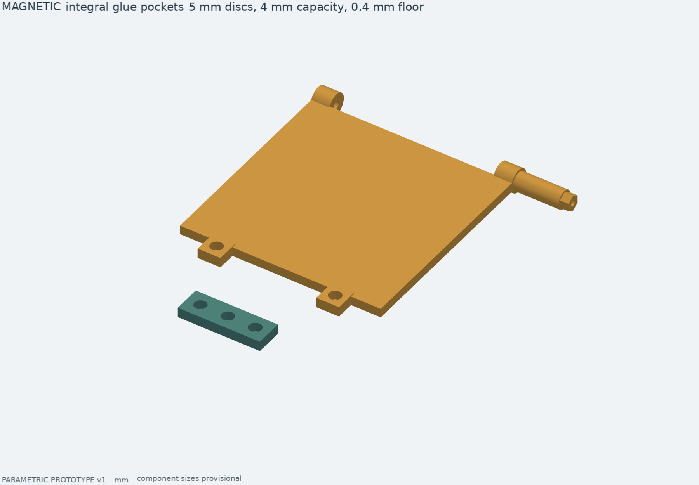
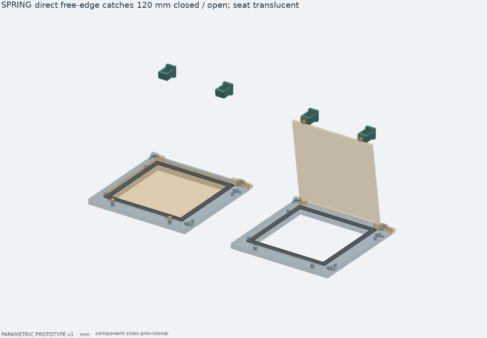
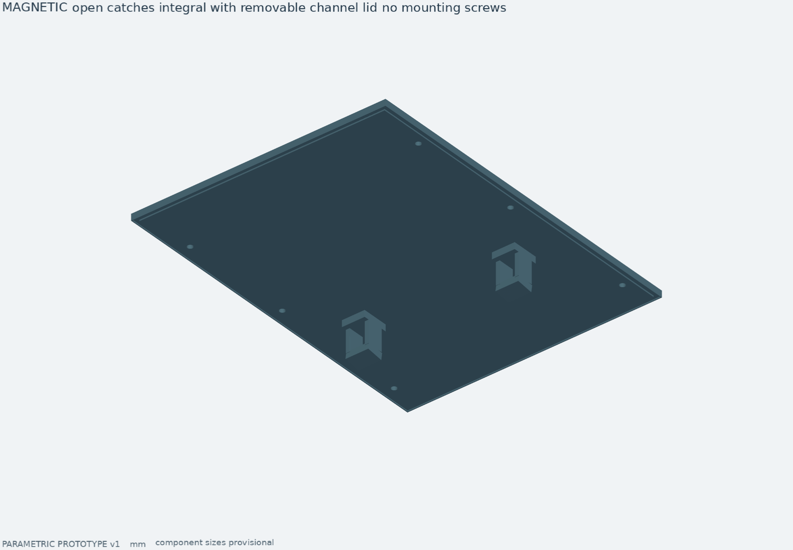
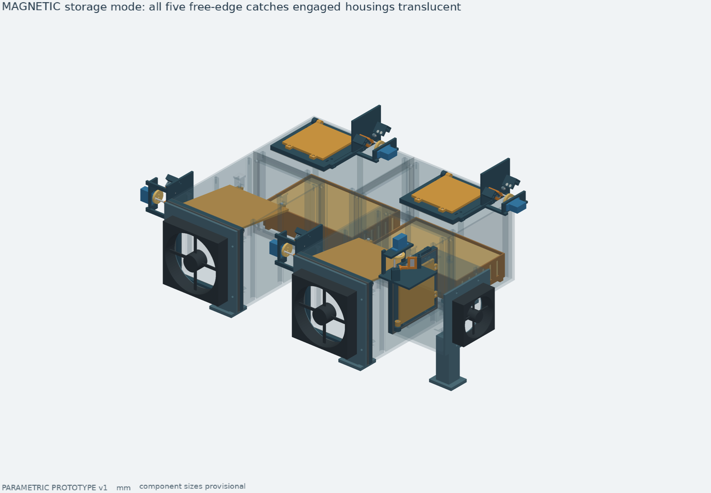
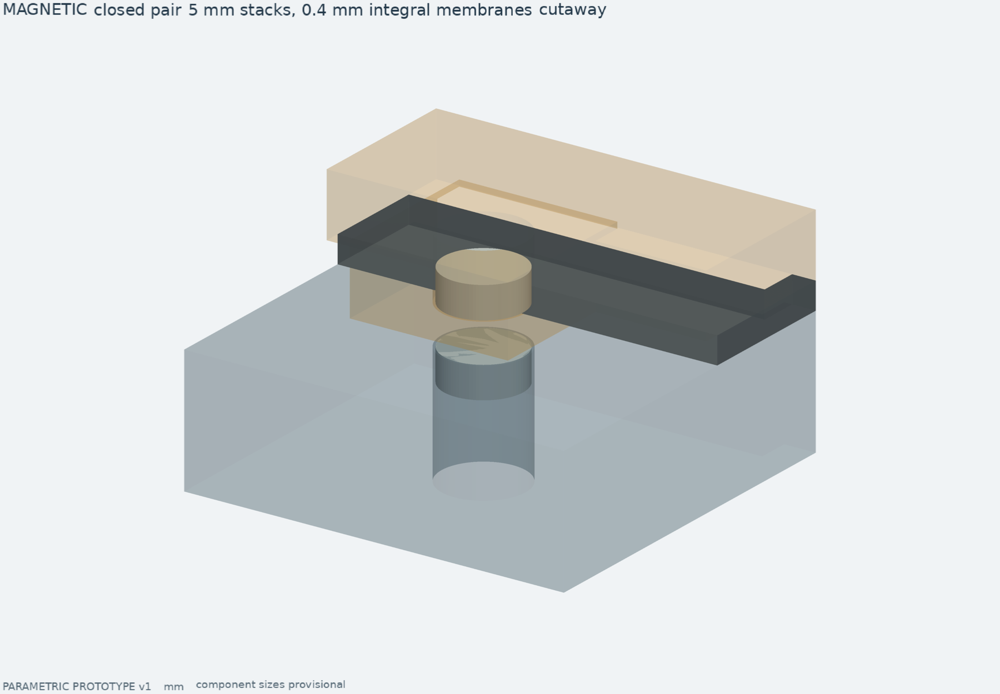

# Два варианта фиксации заслонок

Два механических прототипа для сравнения: **пружина с магнитами на свободном
краю** и **магнитные фиксаторы у оси с такими же магнитами на краю**.
Основной вариант не выбран. Базовая v1 в `cad/drybox_cad/model.py` не изменена.
Герметичность, усилия и работа при нагреве пока не испытаны физически.


| | Пружина + магниты | Магнитная версия |
|---|---|---|
| Параметры | `cad/variants/spring.json` | `cad/variants/magnetic.json` |
| Результаты | `build/cad-variants/spring/` | `build/cad-variants/magnetic/` |
| Фиксатор у оси | Пружина через мёртвую точку | Держатели Ø6×3 и стальной ответный элемент |
| Свободный край | Вклеиваемые стопки Ø5 | Такие же стопки Ø5 |
| Число карманов Ø5 на устройство | 26 | 26 |
| Покупные магниты у осей | Нет | 20 штук Ø6×3 |

Все размеры в миллиметрах. Обе версии включают отдельные сборки 120-мм клапана
ящика, 80-мм входа нагревателя и 80-мм выпуска в двух положениях, а также полные
сборки dry, regenerate, cooling. Файлы одного варианта используйте комплектом.

## Монолитные карманы Ø5 — общие для обеих версий





Вместо отдельных крышечек и винтов на створке выполнены два цельных выступа
с карманами Ø5.3, открытыми со стороны верхней поверхности створки. Они находятся
на свободном краю напротив оси, снаружи контура уплотнения. Толщина дна **0.4**,
глубина кармана **4.0**. Стопка круглых магнитов Ø5 вклеивается в карман и
опирается на дно; суммарную высоту от 1 до 4 мм можно подобрать экспериментально.
На сборках показана стопка высотой 2 мм, например один Ø5×2 или два Ø5×1.
При меньшей стопке верх остаётся утопленным — он не должен выступать над бортиком.

Ответные карманы закрытого положения сделаны непосредственно в рамке и открыты
**с обратной, монтажной стороны**. Магниты вклеиваются вплотную к тонкой стенке
0.4 у верхней поверхности рамки. Доступ нужен до крепления рамки к вентилятору.
Глубина монтажного отверстия рамки 7.6; проверенный габарит стопки ограничен 4 мм.
Не оставляйте стопку на дне монтажного отверстия: её нужно прижать к контактной
мембране и удерживать до отверждения клея.

Ответные карманы открытого положения объединены с крышками двух воздушных каналов
и стенкой кожуха нагревателя. Это единые печатные тела, без отдельных кронштейнов,
крышечек магнитов, M2 и сквозных M3. Крышка самого ящика не меняется.
У верхних выпусков открытых ответных карманов нет.



| Установка | Закрыто | Открыто |
|---|---|---|
| Два клапана 120 мм к ящику | По две пары с рамкой | По две пары с крышкой канала |
| Вход нагревателя 80 мм | Две пары с рамкой | Две пары с кожухом |
| Два выпуска 80 мм | По две пары с рамкой | Держит механизм у оси |

В режиме хранения работают 10 пар на всех пяти створках, при регенерации — 6,
при закрытом охлаждении — 10. Перед снятием крышки канала закройте створку.
В отдельных видах клапана корпус скрыт: зелёные ответные опоры показаны
на своих местах, но печатаются только заодно с крышкой/кожухом.





### Параметры и зазоры

| Параметр | По умолчанию | Проверяемая область |
|---|---:|---|
| `edge_magnet_diameter` | 5 | Ø5 |
| `edge_pocket_diameter` | 5.3 | 5.2–5.4 |
| `edge_membrane` | 0.4 | 0.2–0.4 |
| `edge_stack_capacity` | 4 | 4 |
| `edge_stack_height` | 2 | 1–4, габарит на сборке |
| `edge_open_clearance` | 0.8 | 0.8–1.2, от бортика створки до ответной опоры |

При закрытии между магнитными поверхностями номинально **2.5 мм**: две мембраны
по 0.4 и 1.7 свободного пространства при заданном обжатии прокладки. Стопки
опираются на обращённые друг к другу мембраны, поэтому их высота этот зазор
не меняет. При открытии используется противоположная, открытая сторона магнита
створки: зазор **3.2 мм** для стопки 2 мм и **1.2 мм** для стопки 4 мм. Он включает
мембрану ответного кармана и свободное пространство. Клей под торцом магнита
увеличит фактический зазор; наносите его преимущественно на боковую поверхность.

Паспортные 0.43 кгс для Ø5×2 и 0.2 кгс для Ø5×1 относятся к контакту с толстой
сталью. Это не сила нашей пары через пластик и воздух. Стопки усиливают поле
нелинейно. Измеряйте удержание и отрыв; увеличение стопки может потребовать
большего момента сервы, особенно в открытом положении.

## Механизмы у осей и привод


Пружина растяжения переходит через мёртвую точку на 25° и тянет ротор к одному
из упоров. Номинальные параметры: рычаг R10, неподвижная опора R35, свободная
длина между ушками 32, начальное натяжение 1.5 Н, жёсткость 1.1 Н/мм, наружный
диаметр до 4. Установленная длина около 41.3–45, сила около 11.7–15.8 Н.
Это расчётные требования для подбора, а не данные купленной пружины.
Зелёный цилиндр в сборке — её наружный габарит, без моделирования витков/ушек.
Добавленные магниты увеличивают удержание и усилие переключения.


В магнитной версии сохранён исходный узел у оси: два Ø6×3 в каждом держателе,
стальная магнитная полоса 14×8×2 в роторе, радиус 24. Держатели регулируются
в пазах, номинальный зазор до стали 1.5, включая передний буртик 0.4.
Их прежние крышки и крепёж сохранены: переработка Ø5 относится к свободному
краю и ответным корпусным карманам. Полярность магнитов к стали несущественна;
**полярность каждой пары Ø5 обязательно проверьте до вклеивания**. Нижняя сторона
магнита створки притягивается к рамке, верхняя — к ответной опоре открытого положения.

Общий соосный привод имеет гладкий палец Ø3 и дуговой паз R8.5. Номинальный
свободный ход ±7°, с зазорами около ±8.35°. Выходной ротор ограничен независимыми
механическими упорами 0°/82°. После переключения серва паркуется в середине
свободного хода; статическую нагрузку принимают фиксатор и упоры.
Передаточное отношение во время зацепления 1:1. Обжатие силикона номинально 0.3
при толщине прокладки 2; её реальное усилие не рассчитано.

## Печать и сборка

1. Сначала напечатайте `magnet_fit_coupon`: карманы слева направо Ø5.2, Ø5.3,
   Ø5.4, глубина 4, дно 0.4. Печатайте открытой стороной вверх, слоем 0.2.
   Затем проверьте пробники журнала v1 и соберите один большой клапан.
2. Для дна 0.4 нужны два сплошных слоя по 0.2. Проверьте именно траектории
   слайсера: высота мембраны относительно стола и выступающие шарниры влияют
   на раскладку слоёв и необходимость поддержек. На рамке отверстия с обратной
   стороны требуют проверки мостика Ø5.3 под мембраной. Наклонные опоры на
   крышках/кожухе могут потребовать поддержек; очищайте их без нагрузки на дно.
3. Очистите карманы, проверьте посадку и полярность насухо. Подберите стопку
   высотой до 4 и клей, совместимый с покрытием магнитов, полимером и рабочей
   температурой. Нанесите немного клея по бокам, усадите стопку к мембране.
   Не запрессовывайте магниты с усилием и не используйте мембрану как упор хода.
4. Вклейте закрытые ответные магниты с обратной стороны рамки, затем магниты
   в створку и встроенные опоры открытого положения. Крышки каналов и кожух
   удобнее заполнять до установки. Дайте клею полностью отвердеть.
5. Соберите уплотнение, оси, соосный кронштейн и ротор на шестиграннике.
   Поставьте два упора со втулками Ø6×4, отверстием Ø3.4 и дистанционными шайбами.
   Под пружину нужны M2 с металлическими втулками: неподвижная ID2.2 OD5×10,
   подвижная ID2.2 OD4×4.5; длину уточните под реальные ушки.
6. В магнитной версии установите стальную вставку, её торцевую крышку,
   держатели Ø6×3 с крышками и отрегулируйте зазоры, начиная с максимальных.
7. Входной диск закрепите на штатной качалке SG90 двумя M2, без копирования
   шлицев. Установите серву последней, введя гладкий приводной палец в паз.
   Резьба не должна тереться о паз; рабочая гладкая часть около 25, общий
   габарит пальца 28 с хвостовиком M3.
8. Проверьте полный ход вручную, затем измерьте момент переключения при
   фактической ориентации. Подберите пружину, стопки и серву по измерению.
   Геометрический габарит SG90 не подтверждает достаточность его момента.

## Покупки

На устройство: пять серв с качалками, пять гладких приводных пальцев, комплект
осей и уплотнений, крепёж корпусов/вентиляторов по [ASSEMBLY.md](ASSEMBLY.md).
На каждый клапан: одна M3 с низкой головкой для ротора, две M3 около 12 для
упоров и два набора дистанционных шайб, две M3 крепления кронштейна к рамке,
две M2 для качалки и две M2 для сервы с гайками/шайбами по месту.

Для пружинного комплекта дополнительно пять пружин, десять M2 для ушек и десять
металлических дистанционных втулок. Для магнитного — 20 магнитов Ø6×3,
пять стальных полос 14×8×2, по четыре M3 крепления держателей и по шесть M2
для крышек держателей/стальной вставки на каждый клапан.

**Обоим комплектам нужны 26 стопок Ø5**: 10 на створках, 10 в рамках, 6 на корпусе.
При одном Ø5×2 на карман это 26 магнитов; при двух Ø5×1 — 52. Высоты разных
стопок можно подбирать отдельно; сборка показывает одинаковую высоту из параметра.
Для этих карманов отдельный печатный крепёж и винты не нужны.

## Управление и расчёт нагрузок

Относительные углы для калибровки: открытие примерно до 90.35°, затем парковка
на 82°; закрытие примерно до −8.35°, затем парковка на 0°. Это геометрические
пределы зацепления, не команда постоянно давить в упор. Настройку начните
с меньшего хода. Парковка позволяет снять питание сервы; отсутствие PWM само
по себе не гарантирует отключение питания. Электроника/прошивка сюда не входят.

В отчётах `verification.json` есть оценки массы сплошного полимера при плотности
1.4 г/см³, силы пружины и момента тяжести. Для магнитов условно заданы **0.35 Н
на пару Ø5** и **1.8 Н на магнит–сталь у оси**. Эти числа не получены из паспортных
сил и не подтверждены измерением; они не учитывают изменение силы со стопкой.
Для пружинного варианта приводится максимум момента пружины с тяжестью и
консервативная добавка магнитного отрыва. Для магнитного — сумма условных
моментов магнитов и максимального момента тяжести. Трение и усилие уплотнения
не включены. Эти оценки нужны для планирования испытания, не выбора сервы.

## Пересборка и результаты

```sh
make variants PYTHON=/Users/xartik/3d_models/.venv/bin/python
make variants-package PYTHON=/Users/xartik/3d_models/.venv/bin/python
```

Без графики: `make variants-geometry`, затем `make variants-render`.
Одна версия: `python cad/build_variants.py --kind spring --no-render`
или `--kind magnetic --no-render` из того же окружения.
Экспорты STEP/STL лежат в `build/cad-variants/{spring,magnetic}/exports/`,
количества — в `print_manifest.json`, результаты проверок — в `verification.json`.
Архивы: `dist/filament-dry-box-{spring,magnetic}-prototype.zip`.

Проверяются отдельные твёрдые тела, мембраны, карманы, зазоры пар, движение
и крайние параметры, все пять установок с корпусами, три режима, контакты упоров,
свободный ход привода, STEP после импорта и замкнутость STL. Встроенные опоры
экспортируются в составе своих корпусов. Устаревшие отдельные крышечки и
кронштейны удаляются из результатов при новой сборке. Физические испытания
усилий, посадок, герметичности, ресурса и нагрева пока не выполнены.

Проверка поставки 15.10.2026: обе версии пересобраны из чистых процессов;
базовая v1 также прошла повторную проверку. Все 20 итоговых рендеров просмотрены.

| Комплект | Типов деталей с пробниками | Печатных экземпляров без пробников | Проверок покупной габарит / печатная деталь в ходе клапанов |
|---|---:|---:|---:|
| Пружина + магниты | 32 | 55 | 10 933 |
| Магнитный | 42 | 80 | 19 923 |

В каждой версии изменены семь типов деталей: две крышки каналов, кожух,
рамки и створки двух размеров. Остальные общие детали сохранили размеры и
точный объём относительно `233573f`; добавлен пробник магнитных карманов.
В магнитном комплекте исключены 16 прежних типов отдельных крышечек/кронштейнов.
