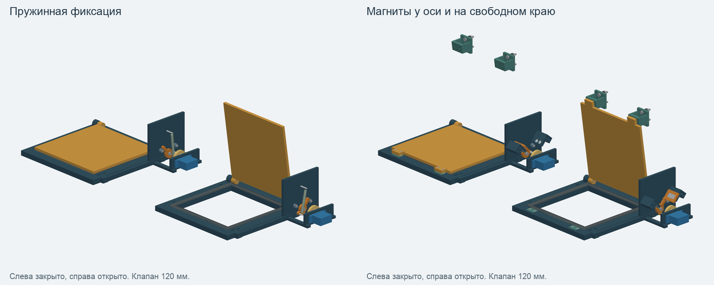
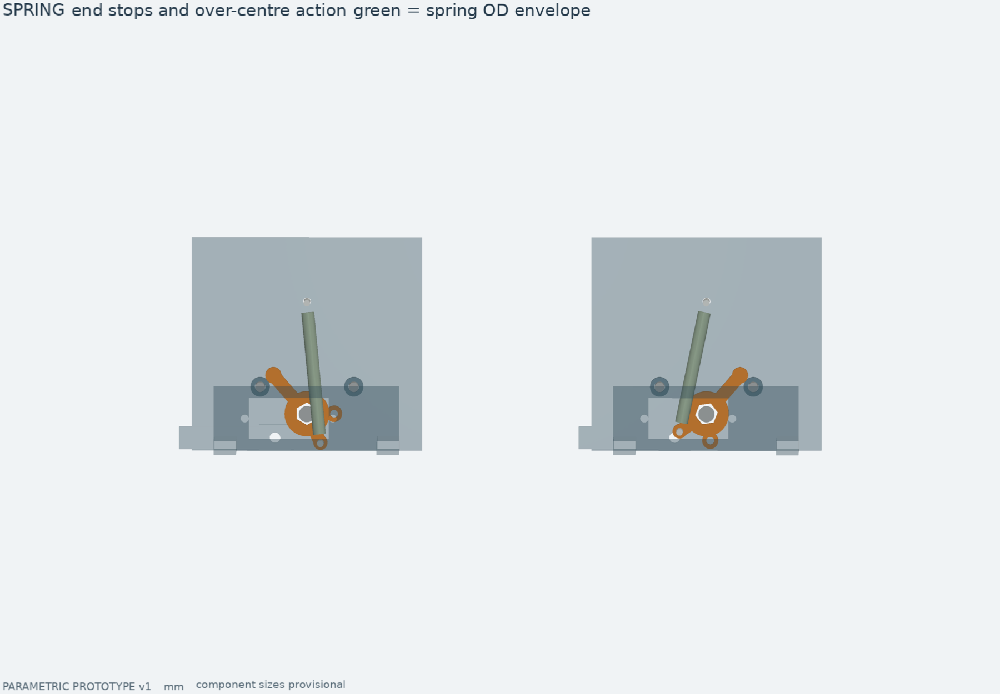
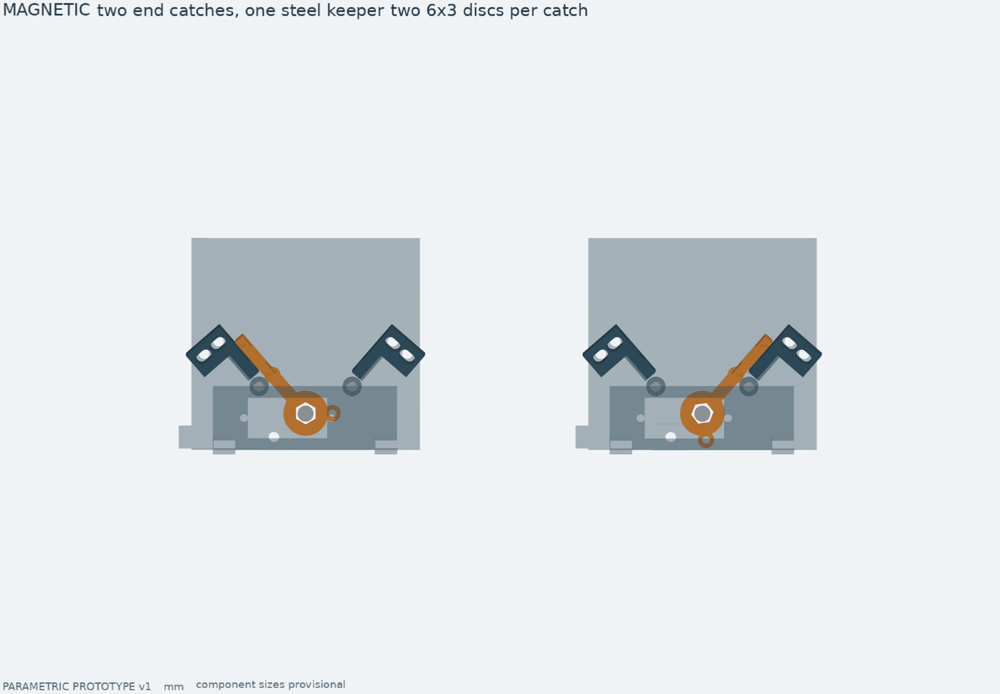
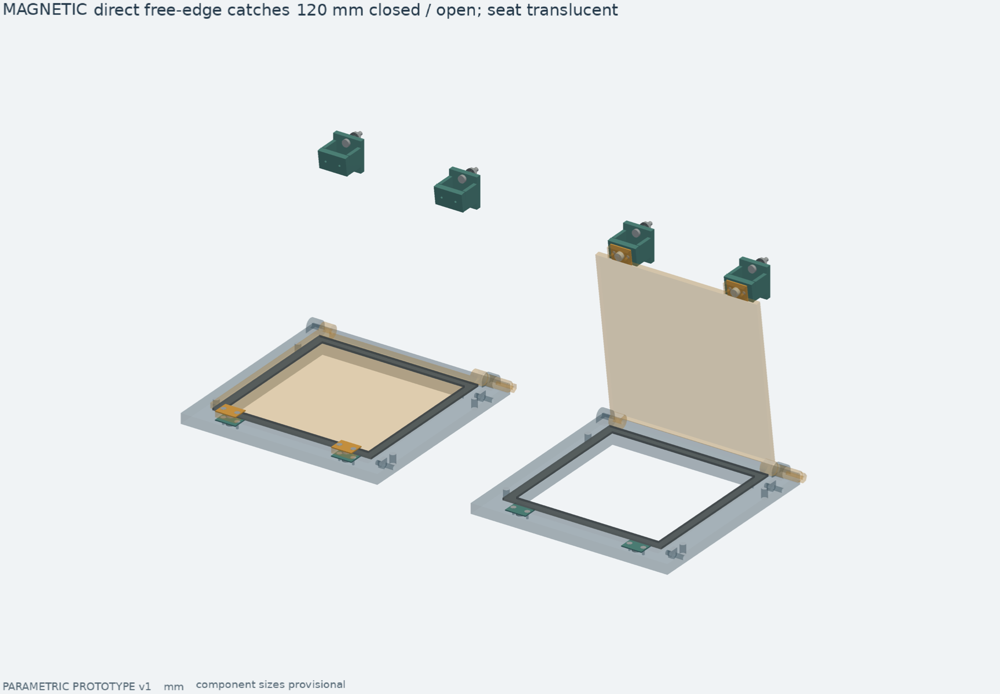

# Два варианта фиксации заслонок

Разработаны **две независимые механические версии для сравнения**. Ни одна
не выбрана основной. Исходная v1 остаётся в `cad/drybox_cad/model.py` и собирается
прежними командами. Новые версии сохраняют уплотнение, оси и отверстия
присоединения и заменяют параллелограммный привод. Магнитная версия дополнительно
имеет карманы на рамке, выступы на свободном краю створки и крепления на корпусе.



Все пути ниже — от корня репозитория, все размеры — мм.

| | Пружина | Магниты |
|---|---|---|
| Конфигурация | `cad/variants/spring.json` | `cad/variants/magnetic.json` |
| Результат сборки | `build/cad-variants/spring/` | `build/cad-variants/magnetic/` |
| Фиксатор | Пружина растяжения, переход через мёртвую точку | Фиксаторы у оси плюс пары магнитов на свободном краю створки и корпусе |
| Что удерживается | Закрытое и открытое положение | Закрытое и открытое положение |
| Основная настройка | Сила/жёсткость пружины, её свободная длина | Зазор между магнитами и сталью |
| Что нужно измерить | Силу пружины по длине, момент переключения, прижим | Силу притяжения на рабочем зазоре, область захвата, момент отрыва |

Обе версии включают клапаны 80 и 120 мм, отдельные STEP-сборки клапанов
в двух положениях и полные сборки приставки в трёх режимах. В магнитной версии
80-мм выпуск и вход нагревателя имеют отдельные сборки. Для печати нужен
комплект только одного варианта: смешивать роторы и держатели двух версий нельзя.

## Общая механика

На крупных планах опорная плита показана полупрозрачно, её длинное нижнее ребро
срезано для наглядности; серва и входной диск скрыты в виде фиксаторов.
Это приём отображения, печатные файлы содержат полный кронштейн.

Серва стоит соосно правому журналу створки. Штатная качалка крепится двумя
M2 к печатному входному диску; копирования шлицев сервы нет. На диске выполнен
дуговой паз с радиусом 8.5 мм. Закреплённый на выходном роторе гладкий стальной
палец Ø3 скользит в этом пазу.

Центральная дуга паза охватывает ±7°. С учётом разницы диаметров паза 3.4 мм
и пальца 3 мм фактический свободный ход центров примерно ±8.35°.
После переключения серва паркуется в середине этого хода, палец не опирается
на стенки паза. Ротор удерживают фиксатор и упор; редуктор не несёт статический
момент от створки. Передача во время зацепления остаётся 1:1: свободный ход
не уменьшает требуемый момент переключения.

Две сменные втулки-упора Ø6, отверстие Ø3.4, длина 4 мм ограничивают выход
ротора положениями 0° и 82°. Они стоят на M3 отдельно от сервопривода.
Конечный угол задаёт контакт ротора с втулкой, а не команда серве.

Створка и рамка сохраняют номинальное обжатие уплотнителя 0.3 мм. Реальное
усилие обжатия в расчёт привода не включено: жёсткий сплошной силиконовый лист
может потребовать существенно большего момента. Для малых приводов сначала
проверьте мягкий закрытоячеистый силиконовый уплотнитель толщиной 2 мм.
Герметичность подтверждается испытанием, не отсутствием зазора в CAD.

## Пружинная версия



На роторе есть короткий рычаг R10 мм. Неподвижный конец пружины закреплён
на расстоянии 35 мм от оси; подвижный проходит напротив него около угла 25°.
В этом положении длина пружины максимальна. По разные стороны от него
пружина тянет ротор к соответствующему упору. Тяжесть створки сдвигает реальный
угол самопереключения: механическая мёртвая точка пружины и равновесие всей
заслонки — разные вещи.

Расчётная, пока не закупленная пружина:

- наружный диаметр не более 4 мм;
- свободная длина между центрами ушек 32 мм;
- начальное натяжение 1.5 Н, жёсткость 1.1 Н/мм;
- установленная длина приблизительно 41.3–45 мм, сила около 11.7–15.8 Н.

Это требования для подбора и проверки, а не характеристики конкретного товара.
Важнее измеренная сила на рабочей длине, чем совпадение свободной длины.
В STEP зелёный цилиндр обозначает наружный габарит пружины с запасом по длине;
витки, ушки и напряжения проволоки по нему не изготавливаются.

Положение фиксированных отверстий изменяется параметрами. После изменения
пружины проверьте знаки суммарного момента у обоих упоров для всех ориентаций:
большие клапаны закрыты вертикально, верхние малые — горизонтально,
боковой клапан вращается вокруг вертикальной оси.

## Магнитная версия



Сохранён наружный секторный узел у оси; к нему добавлены магниты на свободном
краю самой створки и ответные магниты на рамке/корпусе. Ниже сначала описан узел
у оси, затем непосредственный прижим створки.

Радиус ответного элемента — 24 мм. В ротор аксиально вставляется полоса
**обычной магнитной стали 14×8×2 мм**, не немагнитная нержавейка. Пазы по краям
удерживают её поперёк, отдельная крышка с двумя M2 — вдоль оси. Обе плоские
поверхности стальной вставки открыты: одна подходит к закрытому фиксатору,
другая — к открытому.

Каждый фиксатор содержит два дисковых магнита Ø6×3 мм; итого четыре на клапан.
Полярность относительно стальной вставки не принципиальна. Магниты вставляются
сзади до печатного переднего буртика и удерживаются отдельной крышкой на M2;
клей не является единственным креплением. Выберите температурный класс под
фактическую температуру узла при регенерации.

Номинальный зазор от стали до магнита 1.5 мм включает 0.4 мм переднего буртика
держателя. Монтажные пазы дают 2 мм хода вдоль касательной. Каждый держатель
регулируется отдельно: сила открытого и закрытого фиксаторов может различаться.
Твёрдый упор должен срабатывать раньше соприкосновения ротора с держателем;
втулки и винты-упоры не снимаются при регулировке магнитов.

В расчётном примере условно принято 1.8 Н на один магнит на рабочем зазоре:
два магнита дают 86.4 Н·мм удерживающего момента. **Это предположение,
не подтверждённая сила магнитов Ø6×3 мм.** Поле, взаимное влияние магнитов,
насыщение стали и динамический захват не моделировались. Покупную силу отрыва
«вплотную к толстой стали» нельзя подставлять вместо силы на нашем зазоре.
Если установленной силы мало или отрыв слишком тяжёлый, меняйте зазор и
подбирайте магниты; посадка под другой размер требует правки держателя.

### Непосредственный прижим свободного края



[Установка внутри приставки](images/variants/magnetic_edge_installed.png) ·
[Крупный план закрытой пары](images/variants/magnetic_edge_detail.png) ·
[Верхний выпуск в двух положениях](images/variants/magnetic_exhaust_states.png).
В отдельных сборках неподвижные опоры открытого положения показаны без корпуса;
в установленном виде они прикручены к его крышке или стенке.

На каждой жёлтой створке два выступа с магнитами Ø6×3, симметрично вдоль
свободного края, противоположного оси. Ещё два магнита встроены в рамку под
ними. Их центры находятся за наружной границей уплотнения; воздушное отверстие
и шаблон силиконовой прокладки не меняются. В закрытом положении магниты тянут
сам свободный край к рамке. Нагрузка передаётся через створку и уплотнение;
упоры у оси по-прежнему ограничивают угол.

| Место | Ответные магниты при закрытии | Ответные магниты при открытии |
|---|---:|---:|
| Два клапана 120 мм к ящику | По 2 в рамке | По 2 на внутренней стороне крышки канала |
| Вход нагревателя 80 мм | 2 в рамке | 2 на стенке кожуха |
| Два верхних выпуска 80 мм | По 2 в рамке | Нет |

Таким образом, в основном режиме задействованы дополнительные фиксаторы всех
пяти заслонок: две открытые к ящику и три закрытые наружу. При открытии выпусков
их удерживает существующий фиксатор у оси, дополнительные стойки над корпусом
отсутствуют.

Один и тот же магнит створки обращён нижним полюсом к закрытому ответному
магниту и верхним — к открытому. **Проверьте притяжение обеих пар до установки
крышек:** неправильная полярность даст отталкивание. Не переносите сюда правило
«полярность не важна» от магнитов, работающих со стальной вставкой у оси.

Посадки Ø6.3, номинальный зазор между магнитными поверхностями 3.0 мм с учётом
полимерных стенок. Параметр `edge_magnet_gap` допускает 2.8–3.6 мм и требует
пересборки деталей; пазы исходных фиксаторов у оси этот зазор не регулируют.
Магниты удерживаются отдельными крышками на двух M2 с потайной головкой 90°
диаметром не более 4 мм. В крышках и основании предусмотрены совместные зенковки
Ø4.2 глубиной 1 мм: головки должны быть заподлицо, иначе могут мешать движению.
Габариты потайных головок включены в проверку хода; резьбовые хвостовики M2
в STEP опущены. Закрытая крышка рамки
утоплена заподлицо с её поверхностью Z=8; нижняя стенка кармана створки 0.5 мм.
Между движущимися и неподвижными печатными крышками остаётся зазор.

Открытые крепления имеют небольшую опору на корпус. Крышки обоих каналов и
кожух нагревателя в этом варианте получили отверстия Ø3.4. Для каждой опоры
нужны два M3×16, гайки, металлические шайбы и силиконовые уплотнительные шайбы
снаружи корпуса. Это **крышки приставки**, крышка самого ящика не меняется.
При снятии крышки канала сначала закройте заслонку: открытые фиксаторы уйдут
вместе с крышкой. Под крышкой кассеты с сорбентом эти крепления не стоят.

Плечо новых пар относительно оси — 135 мм на клапане 120 мм и 95 мм на 80 мм.
В расчётном примере условно принято всего **0.35 Н на пару магнит–магнит** при
нашем зазоре, отдельно от 1.8 Н на магнит–сталь у оси. Это не результат измерения.
Две пары добавляют 94.5/66.5 Н·мм к моменту отрыва соответственно. Если реальные
магниты сильнее, нагрузка на серву возрастёт. Испытайте сначала один клапан,
при необходимости увеличьте зазор или ослабьте фиксаторы у оси.

## Дополнительные покупки

На один клапан, сверх рамки/створки/уплотнения и левой оси из v1:

| Деталь | Количество | Примечание |
|---|---:|---|
| Серва класса SG90 со штатной качалкой | 1 | Посадочный макет, момент и размер конкретной сервы проверить |
| M3 с низкой головкой и шайбой | 1 | Удержание ротора на шестиграннике |
| Стальной палец Ø3 | 1 | Рабочая гладкая часть около 25 мм, хвостовик M3 длиной 3 мм; общий габарит 28 мм |
| M3 для упоров | 2 | Длина по месту около 12 мм; ось не должна болтаться |
| Дистанционные шайбы упоров | 2 набора | Зазор от опорной плиты до втулки около 1.4 мм |
| M3 для рамки/кронштейна | 2 | Существующие места крепления рамки |
| M2 для штатной качалки и диска | 2 | Болты, гайки и шайбы под выбранную качалку |
| M2 для крепления сервы | 2 | Под выбранную серву, с гайками |
| Пружина и M2 для её ушек | 1 + 2 | Только пружинный вариант; фиксированная ось примерно M2×16, подвижная M2×10 |
| Металлические дистанционные втулки под M2 | 2 | Для пружины: ID2.2, неподвижная OD5×10, подвижная OD4×4.5; длины подогнать под ушки |
| Магниты Ø6×3 у оси | 4 | Только магнитный вариант |
| Магниты Ø6×3 на свободном краю/рамке | 4 | На любой магнитный клапан |
| Магниты Ø6×3 открытого положения | 2 | Кроме двух верхних выпусков |
| Стальная вставка 14×8×2 | 1 | Только магнитный вариант |
| M3 для держателей магнитов | 4 | Два на держатель; длина по толщине узла, ориентир 30 мм |
| M2 для крышек магнитов и вставки | 6 | Четыре для держателей, два для вставки |
| M2×4 потай 90° для створки и открытых крышек | 4 + 4 | Открытых нет у выпусков; головка ≤Ø4, заподлицо |
| M2×5 потай 90° для закрытых ответных крышек | 4 | Головка ≤Ø4, заподлицо |
| M3×16, гайки, шайбы, силиконовые шайбы | По 4 | Крепления открытого положения, кроме выпусков |

Гладкий палец привода — отдельная ответственная деталь: используйте подходящий
плечевой штифт либо стальной пруток Ø3 с нарезанным хвостовиком. Резьба не должна
тереться о дуговой паз. Не заменяйте его длинным голым M2: консольный участок
получается существенно менее жёстким. Резьбовые хвостовики и головки метизов
показаны упрощённо; полную длину и доступ инструмента проверьте на макете.

Для всего устройства нужны пять клапанов: два 120 мм и три 80 мм.
Следовательно, пружин — пять, либо магнитов — **46** и стальных вставок — пять:
20 магнитов у осей, 10 на створках, 10 в закрытых ответных карманах и 6 в открытых.
Дополнительных креплений к корпусу — 12 M3 с гайками, металлическими и силиконовыми
шайбами; дополнительных потайных винтов крышек M2 — 52 (32 M2×4 и 20 M2×5).
Это сверх крепежа узлов у осей.
Общий крепёж корпуса и вентиляторы — по [ASSEMBLY.md](ASSEMBLY.md).

## Сборка одного испытательного узла

1. Сначала напечатайте пробники посадок v1, затем один клапан 120 мм выбранного
   варианта. Отдельные STEP/STL находятся в `exports/parts/` соответствующей версии,
   количество — в её `print_manifest.json`. Для сравнения можно собрать два
   одинаковых клапана с разными фиксаторами.
2. Подгоните журнал и втулки. Подвижные части должны свободно ходить без сервы
   и фиксатора. Пилоты под резьбу рассверлите/нарежьте по фактическому материалу.
3. Установите створку, уплотнение и оси, прикрутите соосный кронштейн. Наденьте
   ротор на шестигранник и закрепите низкой M3 с шайбой. Поставьте упоры M3
   со втулками Ø6 и дистанционными шайбами, затяните без заклинивания втулок.
4. Для пружины закрепите неподвижное ушко и ушко короткого рычага на M2
   с металлическими дистанционными втулками и шайбами. Неподвижная втулка
   занимает участок оси от боковой плиты до ушка (около 10 мм), подвижная —
   от ротора до ушка (около 4.5 мм). Они опираются на плиту/ротор и разгружают
   M2 от длинной свободной консоли. Затягивается пакет крепления втулки; ушки
   при этом должны свободно поворачиваться, не тереться о ротор. В STEP
   мелкий крепёж и эти втулки упрощены/опущены: их размеры задаёт таблица.
   Проверьте удержание обоих положений при фактической ориентации клапана.
5. Для магнитов вставьте сталь в пазы ротора, закройте торцевую крышку.
   Вставьте магниты с задней стороны держателей и прикрутите крышки. Закрепите
   держатели на опорной плите через пазы, сначала с наибольшим зазором.
   Постепенно уменьшайте его отдельно для каждого положения, проверяя отрыв.
   Установите магниты в свободные края створок и в рамки, проверьте полярность,
   закройте крышки. Магниты в рамке лежат под утопленными крышками; уплотнение
   остаётся на прежнем месте. Открытые крепления соберите отдельно, затем
   прикрутите к крышкам каналов/стенке кожуха. На внешнюю сторону каждого
   сквозного болта поставьте силиконовую шайбу, поверх неё металлическую и гайку.
   Печатные опоры имеют разную высоту для 120-мм каналов и кожуха 80 мм —
   используйте `edge_open_bin_bracket` и `edge_open_heater_bracket` по назначению.
   Используйте потайные M2, доведите зенковки по фактическим головкам и проверьте,
   что они не выступают. Под длиной потайного винта понимается полный размер
   вместе с головкой. Не заменяйте такие винты обычными цилиндрическими.
6. Вкрутите гладкий приводной палец в ротор. Диск закрепите на штатной качалке
   двумя M2, затем закрепите качалку штатным центральным винтом на серве.
   Серва с диском устанавливается на кронштейн последней: палец вводится в паз
   при аксиальном сближении. Проверьте гладкий участок по всей толщине диска.
7. До установки электроники вручную проверьте полный ход, упоры, свободный ход
   диска и отсутствие касания пружины/держателей с пальцем. На концах серва
   должна парковаться так, чтобы палец имел свободный ход в обе стороны.
8. Измерьте силу переключения, например динамометром на известном плече.
   Подберите серву с запасом к максимальному измеренному моменту, с учётом
   трения уплотнения и нагрева. Геометрическая совместимость с SG90 не доказывает,
   что любой 9-граммовый привод подходит по моменту.

Соосный кронштейн ориентирован для печати основной боковой плитой на стол.
Его выступающие рёбра и окно сервы могут потребовать поддержек. Ротор и диск
печатайте широкими плоскостями на стол. Держатели магнитов ориентированы
карманами вверх; у тонкого переднего буртика особенно важна аккуратная печать.
Крышечки свободного края печатаются плашмя; опоры открытых фиксаторов — подошвой
на стол, под наклонную часть может потребоваться поддержка. Сначала проверьте
посадку одного магнита в кармане с крышкой; припуск 0.15 мм на радиус не калиброван
под конкретный материал. Небольшой функциональный пробник — одна
`valve80_edge_open_heater_bracket_left` с `valve80_edge_open_cap_left`: по нему
можно проверить посадку магнита и потайного M2 до печати рамки и створки.
Подбирайте температурный класс всех магнитов по нагреву.

## Переключение и отключение сервы

Углы ниже относительные, а не абсолютные значения PWM конкретной сервы.
Нужно откалибровать положение качалки и направление вращения.

- Открыть: повернуть входной диск примерно до 90.35°, дождаться переключения,
  вернуть на 82°, затем отключить питание сервы.
- Закрыть: повернуть примерно до −8.35°, дождаться переключения,
  вернуть на 0°, затем отключить питание сервы.

Это геометрические пределы касания пальца стенки паза, **не команда безусловно
давить сервой в упор**. Первую калибровку выполняйте с меньшего хода, увеличивая
его до надёжного переключения; не удерживайте двигатель на механическом пределе.
Упор выхода ограничивает створку, свободный ход позволяет припарковать вход.
При снятом питании возможное трение/дрейф конкретной сервы проверяется отдельно.
Отсутствие PWM само по себе не равно гарантированному отключению питания.

Прошивка и силовые ключи отключения питания в эту работу не входят.

## Пересборка и проверка

Из корня репозитория:

```sh
make variants PYTHON=/Users/xartik/3d_models/.venv/bin/python
```

Без графики — `make variants-geometry`, затем отдельно `make variants-render`.
Можно собрать одну версию:

```sh
/Users/xartik/3d_models/.venv/bin/python cad/build_variants.py --kind spring --no-render
/Users/xartik/3d_models/.venv/bin/python cad/build_variants.py --kind magnetic --no-render
```

`make variants-package` создаёт два независимых ZIP в `dist/`, с исходниками,
документацией, соответствующими экспортами и отчётом. Отчёты содержат условия
расчёта сил, число проверенных пар и SHA-256 исходников. Изображения после
перерисовки требуют отдельного просмотра; скрипт не отмечает просмотр сам.

Проверки: валидность и однотельность деталей, STEP после повторного импорта,
замкнутость STL, контакты упоров, свободный ход, промежуточные положения,
зазоры с металлическими габаритами, все пять установок относительно корпусов
и оценочной стенки ящика, три рабочих режима и крайние параметры.
Не проверены физические усилия, усталость пружины, магнитная сила, ресурс,
герметичность и горячий режим. Эти две версии — прототипы для испытания.

## Расчётный пример нагрузки

Для номинальных параметров, плотности сплошного полимера 1.4 г/см³ и указанных
выше сил получены следующие значения. Они служат ориентиром для испытания,
а не заменой измеренного момента:

| Реальное место установки | Пружина: максимум идеального момента сервы | Магниты: консервативная оценка отрыва с тяжестью |
|---|---:|---:|
| 120 мм у ящика | около 0.050 Н·м / 0.51 кгс·см | около 0.246 Н·м / 2.51 кгс·см |
| 80 мм сверху | около 0.081 Н·м / 0.82 кгс·см | около 0.176 Н·м / 1.80 кгс·см |
| 80 мм сбоку | около 0.083 Н·м / 0.85 кгс·см | около 0.153 Н·м / 1.56 кгс·см |

Трение, усилие уплотнителя, потери в соединениях и ускорение сюда не входят.
Для магнитов полная зависимость усилия от угла неизвестна; оценка складывает
номинальные моменты магнитов у оси и на свободном краю и максимальный момент
тяжести с запасом. Масса подвижных деталей учитывает новые выступы, крышки и
магниты. Эта верхняя оценка не моделирует спад притяжения по мере открытия.
При таких условных силах запас обычного SG90 на большом клапане сомнителен:
сначала измерьте фактический момент и настройте фиксаторы, затем выбирайте серву.
Для пружины посчитана сумма моментов на сетке углов 0–82° с шагом 0.5°.

На большом клапане пружина в открытом положении даёт около 83 Н·мм,
тяжесть отнимает около 60 Н·мм. В закрытом положении остаётся около 50 Н·мм
для прижима к уплотнителю — эквивалент примерно 0.38 Н на свободном краю.
Это небольшое усилие; если уплотнитель требует больше, одной замены сервы
недостаточно для удержания при выключенном питании: потребуется усилить
сам фиксатор либо изменить уплотнение и повторить расчёт/испытание.

Для большого магнитного клапана максимальный момент тяжести около 64.8 Н·мм.
В открытом положении его компенсируют оба набора фиксаторов: 86.4 Н·мм у оси
и 94.5 Н·мм на краю при принятых силах. Каждую силу нужно измерить с нашими
ответными деталями и зазорами; при необходимости ослабьте узел у оси, сохраняя
достаточный общий момент удержания. Магниты не должны заменять механические упоры.

Число деталей, проверенных пар, сборок и результаты просмотра изображений
записаны в `build/cad-variants/{spring,magnetic}/verification.json`. Отдельно
проверяются зазоры каждой новой магнитной пары и отсутствие открытых креплений
у выпусков. В основном режиме совпадают все 10 новых пар на пяти заслонках,
при регенерации — 6, при закрытом охлаждении — 10.

Проверка поставки 15.10.2026: `make variants` завершён успешно. Магнитный комплект
содержит 57 типов печатных деталей, 112 печатных экземпляров и 9 STEP-сборок;
проверено 59 595 сочетаний покупных габаритов с печатными деталями, включая
потайные головки. Все 8 итоговых изображений магнитной и 4 пружинной версии
просмотрены. У 31 печатной детали пружинной версии сохранены прежние размеры
и объёмы; повторная проверка базовой v1 также прошла.
